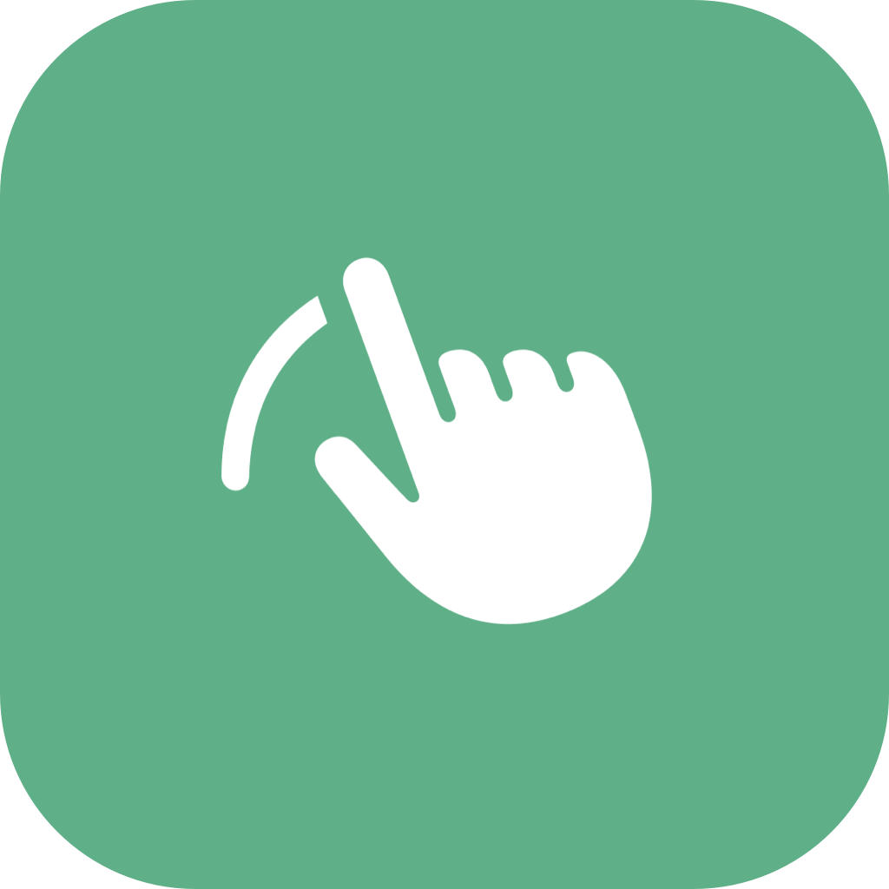
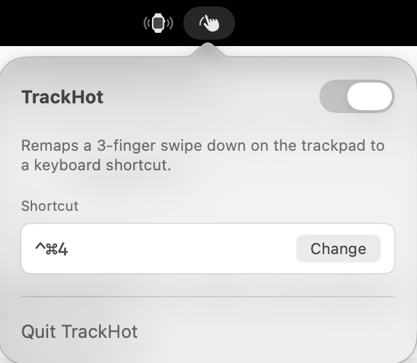

<div align="center">
  
  <h1>TrackHot</h1>
  <p><b>A tiny macOS menu-bar app that turns a three-finger swipe down on your trackpad into any keyboard shortcut you choose.</b></p>
</div>

---

Swipe down with three fingers and TrackHot fires the shortcut you assigned. I use it to take screenshots without reaching for the keyboard. That's the whole app.



TrackHot is the trackpad sibling of [ScrollHot](https://github.com/technomaybe/ScrollHot), which does the same thing for a mouse's scroll-wheel click. You can run both and point them at the same shortcut.

## Features

- Map a three-finger swipe down to any modifier + key combination (or a function key).
- Works with the built-in MacBook trackpad and the Magic Trackpad.
- Ignores four-finger swipes, so it won't collide with Mission Control or App Exposé on four fingers.
- Lives in the menu bar only. No Dock icon, no windows.
- Shows the current shortcut at a glance. Changing it takes a deliberate click on **Change**, so a stray click can't overwrite it.
- Shows a "last fired" time so you can confirm it's working.
- Remembers your shortcut and on/off state between launches.

## Requirements

- macOS 13.0 (Ventura) or later
- A Mac trackpad (built-in or Magic Trackpad)
- Xcode 15 or later to build from source

## Before you start: free up the gesture

macOS uses three-finger swipes for its own features out of the box, and they'll fire alongside TrackHot unless you move them.

1. **Move Mission Control and App Exposé to four fingers.** Go to System Settings → Trackpad → More Gestures and set both to the four-finger option.
2. **Watch out for Three Finger Drag.** If it's on, a three-finger swipe also drags the pointer and will highlight any text it passes over before your shortcut fires. Turn it off, or pick a different dragging style, under System Settings → Accessibility → Pointer Control → Trackpad Options.

## Install

### Download

Grab `TrackHot-<version>.zip` from the [Releases](https://github.com/technomaybe/TrackHot/releases) page, unzip it, and drag **TrackHot.app** into `/Applications`.

TrackHot isn't signed with an Apple Developer ID or notarized, so macOS will block it the first time. To open it anyway, try to launch it once, then go to System Settings → Privacy & Security and click **Open Anyway**. Or clear the download flag from Terminal:

```bash
xattr -dr com.apple.quarantine /Applications/TrackHot.app
```

### Build from source

```bash
git clone https://github.com/technomaybe/TrackHot.git
cd TrackHot
open TrackHot.xcodeproj
```

In Xcode, pick your team under Signing & Capabilities (or choose "Sign to Run Locally"), then press **⌘R**.

To build the same zip that goes on the Releases page:

```bash
./scripts/build-release.sh
```

It writes `build/TrackHot-<version>.zip`.

## First-run permission

TrackHot posts keystrokes on your behalf, which needs **Accessibility** permission. On newer macOS versions this list is called **Device Control and Data Access**.

On first launch macOS asks for it. Click **Open System Settings** and switch TrackHot on. The popover shows an orange warning until it's granted.

A few things that can trip you up:

- **The prompt can open on another desktop.** If you don't see it, check your other Spaces and displays.
- **Every new build needs the permission again.** Without a Developer ID, macOS ties the grant to that exact build, so after updating or rebuilding, clear the old entry and relaunch:

  ```bash
  tccutil reset Accessibility com.patrickschroeder.trackHot
  ```

TrackHot runs without the App Sandbox on purpose. A sandboxed app can't read the trackpad or post keystrokes system-wide. See `TrackHot/TrackHot.entitlements`.

## Usage

1. Click the hand icon in the menu bar to open the popover.
2. Click **Set** (or **Change**) and press the keys you want, for example `⌃⌘4` or `⇧⌘4`. Press `Esc` to cancel or `Delete` to clear.
3. Make sure the toggle at the top is on.
4. Swipe down with three fingers. TrackHot fires your shortcut.

## How it works

Standard `NSEvent` monitors don't deliver trackpad gestures to background apps, so TrackHot reads the trackpad directly through `MultitouchSupport`, the private Apple framework that tools like BetterTouchTool and MiddleClick rely on. It reports the position of every finger on the trackpad, many times a second.

When exactly three fingers land, TrackHot notes where they started. Once their average position moves down far enough (12% of the trackpad's height) and more down than sideways, it fires the shortcut once, then waits for your fingers to lift before arming again. A fourth finger cancels the swipe.

| Piece | Role |
| --- | --- |
| `EventMonitorService` | Loads `MultitouchSupport`, listens to every trackpad, and detects the three-finger swipe down. |
| `HotKeyEmitter` | Posts synthetic key-down and key-up events for your shortcut. |
| `HotKey` | Codable key code + modifier flags, with a display string like `⌃⌘4`. |
| `SettingsStore` | Saves the shortcut and on/off state in `UserDefaults`. |
| `StatusBarController` | Owns the menu-bar icon and the popover. |
| `ContentView` / `HotKeyRecorderView` | The SwiftUI popover and the AppKit key-recorder field. |

Because `MultitouchSupport` is private, TrackHot can't be sold in the Mac App Store, and a future macOS update could break it.

## Troubleshooting

To watch what TrackHot sees while you swipe, run this in Terminal:

```bash
log stream --predicate 'subsystem == "com.patrickschroeder.trackHot"'
```

You'll see a line for each detected swipe and whether the shortcut fired. If a swipe is ignored, the log says why (TrackHot is off, no shortcut is set, or Accessibility permission is missing).

## Project layout

```
TrackHot/
├── TrackHotApp.swift           # App entry point (menu-bar accessory)
├── AppDelegate.swift           # Launch, starts the trackpad listener, asks for permission
├── Models/
│   └── HotKey.swift
├── Services/
│   ├── EventMonitorService.swift
│   ├── HotKeyEmitter.swift
│   └── SettingsStore.swift
└── Views/
    ├── StatusBarController.swift
    ├── ContentView.swift
    └── HotKeyRecorderView.swift
scripts/
└── build-release.sh            # Builds and zips a release
```

## License

[MIT](LICENSE) © 2026 Patrick Schroeder
